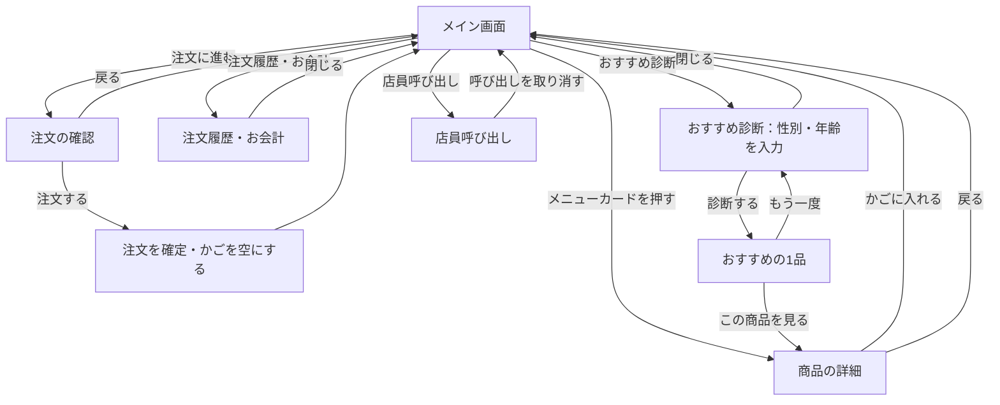

# ASD

レストランのテーブルに置くタブレット向けの、オーダーシステムです。
お客さんが自分でメニューを選んで注文し、注文履歴やお会計金額の確認、店員の呼び出しができます。

ファミリーレストランの席のタブレット注文を参考にしています。店名「ASDダイニング」とメニュー・価格はすべて架空です。

## 目次

- [動かし方](#動かし方)
- [使う技術](#使う技術)
- [ファイル構成](#ファイル構成)
- [画面構成](#画面構成)
- [機能一覧](#機能一覧)
- [画面の流れ](#画面の流れ)
- [データ設計](#データ設計)
- [今後の予定](#今後の予定)

## 動かし方

1. `index.html` をブラウザで開きます。
2. テーブル番号を変えたいときは、`index.html?table=5` のように URL の後ろに付けて開きます（指定しないときは 12）。

サーバーやインストールは必要ありません。

## 使う技術

- HTML・CSS・JavaScript（素の JavaScript）
- フレームワーク（React など）は使わない
- データの保存はブラウザの `localStorage`

まずは1台で動く形にしています。端末どうしの連携が必要になったら、サーバーの追加を検討します（[今後の予定](#今後の予定)）。

## ファイル構成

| ファイル | 役割 |
|---|---|
| `index.html` | 画面の骨組み（ヘッダー、カテゴリ、メニュー、注文かご、各モーダル） |
| `style.css` | 見た目と、画面幅に合わせたレイアウトの切り替え |
| `app.js` | メニューのデータと、画面の動き・保存の処理 |
| `images/` | メニュー画像（`メニューID.jpg`） |
| `images/PROMPTS.md` | メニュー画像を作るための画像生成プロンプト |
| `CLAUDE.md` | Claude Code 向けの作業ガイド |

## 画面構成

### メイン画面

```
┌─────────────────────────────────────────────────────────┐
│ ASDダイニング [テーブル 12]   [注文履歴・お会計] [店員呼び出し] │  ← ヘッダー
├──────────┬──────────────────────────────┬──────────────┤
│ 本日のおすすめ│ 本日のおすすめ               │ 注文かご       │
│ ハンバーグ │  ┌──────┐ ┌──────┐ ┌──────┐ │  商品 ×2  ¥   │
│ 定食・ごはん│  │ 画像  │ │ 画像  │ │ 画像  │ │  [−] 2 [＋]   │
│ パスタ・ピザ│  │ 名前  │ │ 名前  │ │ 名前  │ │              │
│ サイド     │  │ 価格  │ │ 価格  │ │ 価格  │ │ 合計     ¥   │
│ ドリンク   │  └──────┘ └──────┘ └──────┘ │ [注文に進む]   │
│ デザート   │                              │              │
└──────────┴──────────────────────────────┴──────────────┘
   カテゴリ           メニュー一覧                 注文かご
```

画面の幅によって並びが変わります。

| 画面の幅 | 並び |
|---|---|
| 961px 以上（タブレット横・PC） | カテゴリ ｜ メニュー ｜ 注文かご の3列 |
| 601〜960px | カテゴリ ｜ メニュー の2列。注文かごは下 |
| 600px 以下（スマホ） | 1列。カテゴリは横スクロール |

### モーダル（画面の上に重ねて開く小さな画面）

| モーダル | 開き方 | 内容 |
|---|---|---|
| 商品の詳細 | メニューカードを押す | 画像、説明、オプション、個数、「かごに入れる（金額）」 |
| 注文の確認 | 「注文に進む」を押す | かごの中身と合計、「注文する」 |
| 注文履歴・お会計 | 「注文履歴・お会計」を押す | 注文ごとの時刻と商品、お会計金額 |
| おすすめ診断 | 「おすすめ診断」を押す | 性別と年齢の入力、「診断する」。結果ではおすすめの1品と「この商品を見る」「もう一度」 |
| 店員呼び出し | 「店員呼び出し」を押す | 「店員を呼んでいます」、「呼び出しを取り消す」 |

## 機能一覧

| 機能 | 内容 |
|---|---|
| 本日のおすすめ | ドリンク以外のメニューからランダムで3品を選び、最初のカテゴリ「本日のおすすめ」に表示する。選び方は日付で決まり、同じ日なら何度開いても同じ3品になる。ほかのカテゴリでも、おすすめの商品には「本日のおすすめ」の印を付ける |
| おすすめ診断 | ヘッダーの「おすすめ診断」から、性別（男性・女性・回答しない）と年齢を入力すると、おすすめを1品表示する。年齢で候補を決め、性別で選ばれやすさを変えて、候補の中からランダムに選ぶ。お酒は20歳以上にだけおすすめする。入力した内容は保存しない |
| カテゴリ切り替え | 左のカテゴリを押すと、そのカテゴリのメニューだけを表示する |
| メニュー画像 | `images/メニューID.jpg` を表示する。画像がなければ絵文字を表示する |
| アレルギー表示 | 特定原材料8品目（えび・かに・くるみ・小麦・そば・卵・乳・落花生）のうち含むものを、メニューカードと商品の詳細に表示する。詳細では選んだオプションの分も足して表示する。含むものがなければ「特定原材料なし」と表示する |
| オプション選択 | ライス・ソース・ドリンクバー・サイズなど、商品ごとに決められたオプションを1つずつ選ぶ。追加料金は金額に反映する |
| 個数選択 | 詳細画面で、かごにあと入れられる個数まで選べる |
| 注文の上限 | 1回の注文でかごに入れられるのは合計20個まで（`app.js` の `MAX_ITEMS`）。詳細画面でも注文かごの「＋」でも、上限を超えて増やせない。かごには「3 / 20個」のように今の個数を表示する |
| 注文かご | 同じ商品・同じオプションは1行にまとめる。「−」「＋」で個数を変え、0個で削除する |
| 注文の確認と確定 | 確認画面で「注文する」を押すと確定し、かごを空にして「ご注文を承りました」と表示する |
| 注文履歴・お会計 | そのテーブルの注文を時刻ごとに表示し、合計をお会計金額として表示する。支払いはレジで行う |
| 店員呼び出し | 呼び出し中の画面を表示する。今は表示のみで、実際には誰にも届かない |
| テーブル番号 | URL の `?table=` で指定した番号をヘッダーに表示する |
| 保存 | 注文かごと注文履歴を `localStorage` に保存し、ページを閉じても残す |

## 画面の流れ



## データ設計

### メニュー（`app.js` の `MENU`）

| 項目 | 型 | 内容 | 例 |
|---|---|---|---|
| `id` | 数値 | メニューの番号。画像のファイル名にも使う | `1` |
| `category` | 文字列 | カテゴリ名 | `"ハンバーグ"` |
| `emoji` | 文字列 | 画像がないときに出す絵文字 | `"🍖"` |
| `name` | 文字列 | 商品名 | `"ハンバーグステーキ"` |
| `price` | 数値 | 基本の価格（円） | `790` |
| `desc` | 文字列 | 説明文 | `"ふっくら焼き上げた定番ハンバーグ。"` |
| `options` | 文字列の配列 | 選べるオプションの種類（`OPTION_GROUPS` のキー） | `["sauce", "rice", "drinkbar"]` |
| `allergens` | 文字列の配列 | 含むアレルギー（`ALLERGENS` にある名前）。なければ空の配列 | `["小麦", "卵", "乳"]` |
| `image` | 文字列（省略可） | 画像のパス。省略すると `images/id.jpg` | `"images/1.png"` |

カテゴリは、先頭が「本日のおすすめ」で、そのあとは `MENU` に出てくる順に並びます。

### オプション（`app.js` の `OPTION_GROUPS`）

| キー | 表示名 | 選択肢（追加料金） |
|---|---|---|
| `rice` | ライス | なし（0）／普通（+180）／大盛り（+240） |
| `sauce` | ソース | デミグラス（0）／和風おろし（0）／チーズ（+100） |
| `drinkbar` | ドリンクバー | なし（0）／セットにする（+250） |
| `size` | サイズ | レギュラー（0）／ラージ（+150） |

最初の選択肢が初期値です。

選択肢に `allergens` を書くと、その選択肢を選んだときにアレルギーが加わります。今は「ソース：チーズ」と「ドリンクバー：セットにする」に `乳` が付いています。

### アレルギー（`app.js` の `ALLERGENS`）

表示の対象にする特定原材料8品目です。この順番で表示します。

`えび`・`かに`・`くるみ`・`小麦`・`そば`・`卵`・`乳`・`落花生`

今のアレルギー情報は、メニューと同じく架空のものです。実際のお店で使う場合は、本当の原材料をもとに必ず確認して書き直してください。

### おすすめ診断（`app.js` の `AGE_GROUPS`・`GENDER_BOOST`）

年齢ごとのおすすめ候補（メニューID）です。

| 年齢 | 表示名 | 候補 |
|---|---|---|
| 0〜12歳 | お子さま | 1, 2, 6, 9, 14, 19 |
| 13〜19歳 | 10代 | 2, 4, 8, 15, 17 |
| 20〜39歳 | 20〜30代 | 3, 7, 10, 13, 17 |
| 40〜59歳 | 40〜50代 | 4, 5, 13, 18 |
| 60歳以上 | 60代以上 | 1, 11, 14, 18, 20 |

性別ごとに、選ばれやすくする商品です。候補の中にあれば、ほかの候補の2倍選ばれやすくなります。

| 性別 | 選ばれやすくする商品 |
|---|---|
| 男性 | 1, 2, 3, 4, 5, 17, 18（ボリュームのあるもの） |
| 女性 | 10, 11, 14, 15, 16, 19, 20（軽めのもの・甘いもの） |
| 回答しない | なし |

### 保存するデータ（`localStorage`）

**注文かご**（キー：`asd-cart-v2`）

```js
[
  { id: 1, choices: { sauce: 0, rice: 2, drinkbar: 1 }, qty: 2 }
]
```

- `choices` は「オプションのキー：選んだ選択肢の番号」です。
- 金額はメニューのデータから毎回計算します。

**注文履歴**（キー：`asd-orders-v2`）

```js
[
  {
    time: 1760850000000,
    lines: [
      { name: "ハンバーグステーキ", options: "ソース：デミグラス / ライス：大盛り / ドリンクバー：セットにする", price: 1280, qty: 2 }
    ]
  }
]
```

- `time` は注文した時刻（ミリ秒）です。
- `price` はオプション込みの1個の値段です。あとでメニューの価格を変えても、過去の注文の金額が変わらないように、注文した時点の名前と値段をそのまま残します。

## 今後の予定

- **キッチン画面:** 届いた注文を一覧で見て、「調理済み」にできる画面
- **端末どうしの連携:** 客席のタブレットからキッチンに注文を送り、店員呼び出しも実際に届くようにする。サーバー（Node.js や Firebase など）が必要
- **お会計の処理:** 会計済みにして、そのテーブルの履歴をリセットする
- **メニュー画像:** 生成した画像を確認し、必要ならフリー素材の写真に差し替える
